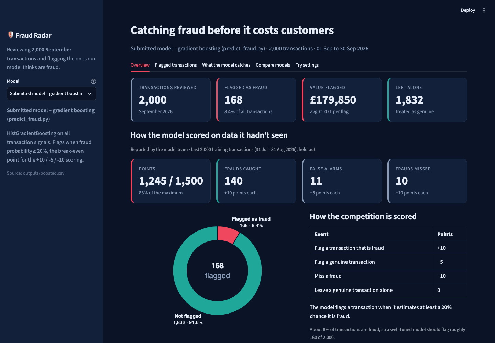
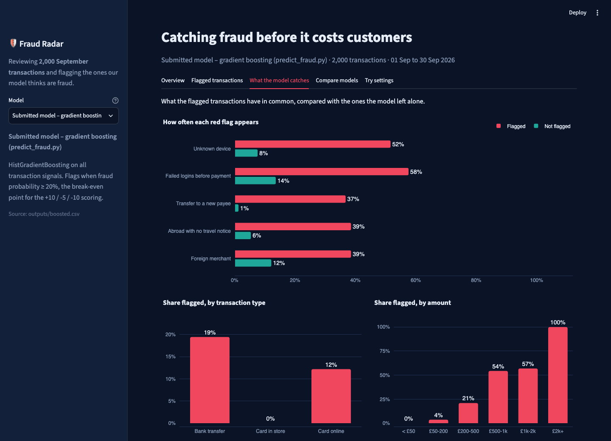
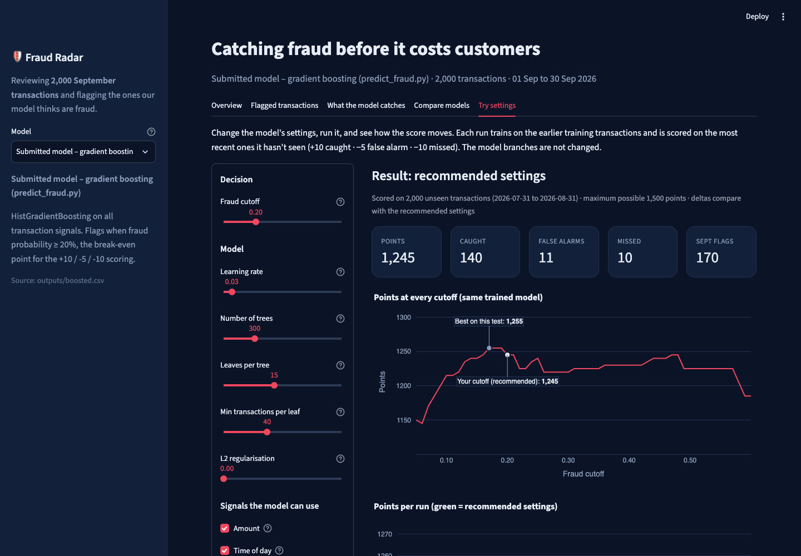

# 🛡️ Fraud Radar

**Catching card and bank-transfer fraud before it costs customers.** Built at the DEFEND hackathon: a gradient-boosting model that flags fraudulent transactions, explains every flag, and an interactive app that lets you explore and tune it.

[](https://defend-hackathon-winning-team.streamlit.app)


<p align="center">
  <a href="https://defend-hackathon-winning-team.streamlit.app"></a>
</p>

## The challenge

A bank's transactions, all synthetic: **10,000 labelled** (April–August) to learn from and **2,000 unlabelled** (September) to judge. About 8% are fraud, and some is deliberately hard to spot. Every decision is scored:

| Decision | Points |
|---|---|
| Flag a transaction that is fraud | **+10** |
| Flag a genuine transaction | **−5** |
| Miss a fraud | **−10** |
| Leave a genuine transaction alone | 0 |

Judges also marked the team's reasoning, so every flag had to come with an explanation.

## Approach

1. **Validate like the real thing.** September comes *after* the training data, so models are trained on earlier months and scored on the most recent ones, never on a random shuffle.
2. **Gradient boosting** ([`predict_fraud.py`](predict_fraud.py)) on all transaction signals beat the starter decision tree by a wide margin: **1,245 vs 600 points** on the last 2,000 labelled transactions.
3. **Cut-off from the scoring rules, not guesswork.** Flagging a transaction with fraud probability *p* is worth 10*p* − 5(1−*p*); not flagging it is worth −10*p*. Flagging wins when **p > 0.20**, so that's the cut-off.
4. **Explain every flag.** For each flagged transaction, each signal is swapped for a typical genuine value; the signals whose swap lowers the score most become the reasons, e.g. *"Bank transfer · New payee · £1,200"*.

## Results

| | Starter tree | **Submitted model** |
|---|---|---|
| Points (last 2,000 labelled, max 1,500) | 600 | **1,245** (83%) |
| Frauds caught | 105 | **140** |
| False alarms | 0 | **11** |
| Frauds missed | 45 | **10** |
| September transactions flagged | – | **168 of 2,000** (8.4%) |

### What fraud looks like in this data



- **Round amounts:** 72% of fraud are exact £100 multiples, against 9% of genuine transactions.
- **Account takeover:** 52% of flagged transactions are on an unknown device (8% of the rest); 58% follow failed logins (14%).
- **Scam transfers:** 37% of flagged transactions go to a new payee, against 1% of the rest.
- **Abroad without telling the bank:** 39% vs 6%.
- **Channel:** none of the 4,110 in-store card payments in the training data were fraud; 17.5% of bank transfers and 12% of online card payments were.
- **Customer history didn't help:** per-customer features (velocity, usual amount and hour) made the score slightly *worse*. Fraud here is about the transaction, not a change in the customer's behaviour.

## The app

**[defend-hackathon-winning-team.streamlit.app](https://defend-hackathon-winning-team.streamlit.app)**: explore the predictions and compare every model the team built.

| Tab | What it shows |
|---|---|
| **Overview** | Headline numbers, the model's score on unseen data, the scoring rules |
| **Flagged transactions** | Filterable list of every flag with its reasons; click one for full details |
| **What the model catches** | How flagged transactions differ from the rest |
| **Compare models** | Which transactions two models agree and disagree on |
| **Try settings** | Change the cut-off, tree settings and signals, re-run, and compare runs |



## Team experiments

Five models were built in parallel. All are in [`experiments/`](experiments) and selectable in the app; they agree on about 99% of September transactions.

| Model | Idea | Own test score |
|---|---|---|
| **Submitted** ([`predict_fraud.py`](predict_fraud.py)) | Gradient boosting on all signals, 20% cut-off | 1,245 / 1,500 |
| [Optimised features](experiments/sid_optimised_features) | Hand-built fraud patterns, noisy columns dropped | 1,235 / 1,500 |
| [Tuned boosting](experiments/jack_tuned_boosting) | Tuned trees + red-flag combinations, 4-fold time validation | 1,215 / 1,500 |
| [Ensemble + cut-off search](experiments/chris_threshold_search) | Boosting + random forest + extra trees | 1,250 / 1,500 \* |
| [Configurable decision tree](experiments/ij_decision_tree) | Tree or weighted rules driven by `config.json` | 1,260 / 1,600 † |

\* cut-off picked on the same data it's scored on, so optimistic. † scored on random rows rather than the latest month, so not directly comparable. Details in [experiments/README.md](experiments/README.md).

## Run it yourself

```bash
git clone https://github.com/jack-bew-code/defend-hackathon.git
cd defend-hackathon
python3 -m venv .venv && source .venv/bin/activate
pip install -r requirements.txt

python predict_fraud.py      # validate, then write test_predictions.csv
streamlit run app.py         # open the app at http://localhost:8501
```

## Project structure

```
├── predict_fraud.py         submitted model: validation, training, explained predictions
├── app.py                   Streamlit app
├── ui/                      app helpers: data loading, charts, styling, "Try settings" engine
├── outputs/                 each model's September predictions (+ its own reported score)
├── experiments/             the team's alternative models
├── src/data.py              shared data loader
├── starter_notebook.ipynb   organisers' walkthrough, updated with the final model
├── train.csv / test.csv     competition data (synthetic)
└── docs/screenshots/        images for this README
```

## Team

Built by [@jack-bew-code](https://github.com/jack-bew-code), [@Infinite-ai-1](https://github.com/Infinite-ai-1), [@siddharthdontukurthi05-maker](https://github.com/siddharthdontukurthi05-maker), [@cpint2410](https://github.com/cpint2410), [@thesyntaxerrorwizard](https://github.com/thesyntaxerrorwizard) and [@S1DNEONSEO](https://github.com/S1DNEONSEO).

📊 [Presentation slides](https://1drv.ms/p/c/452bbf4f79367bf5/IQAgpFwCxMoKRpprHfZaDRsdAQ55lPyPNkZUw1Ga3Bgbkoo)

<details>
<summary><b>Data dictionary</b></summary>

All data is synthetic. `train.csv` has an extra `is_fraud` column; `test.csv` does not. Flags are 1 (yes) or 0 (no).

| Column | Meaning |
|---|---|
| `transaction_id` | Unique transaction reference ID |
| `timestamp` | When it happened |
| `customer_id` | Customer reference number |
| `account_type` | STUDENT, CURRENT or PREMIUM |
| `typical_monthly_spend_gbp` | The customer's normal monthly spend |
| `transaction_type` | CARD_IN_STORE, CARD_ONLINE or BANK_TRANSFER |
| `amount_gbp` | Amount in pounds |
| `amount_vs_typical` | `amount_gbp` divided by `typical_monthly_spend_gbp` |
| `hour_of_day` | Hour of the transaction, 0–23 |
| `merchant_country` | Country of the shop or recipient (GB, FR, ES, US) |
| `foreign_transaction` | 1 if the country is not GB |
| `unknown_device` | 1 if the customer had not used this device before |
| `failed_logins` | Failed login attempts just before the transaction |
| `new_payee` | 1 if a transfer went to a recently added recipient |
| `travel_notice` | 1 if the customer told the bank they were travelling to that country |
| `is_fraud` | (`train.csv` only) 1 = fraud, 0 = genuine |

</details>
